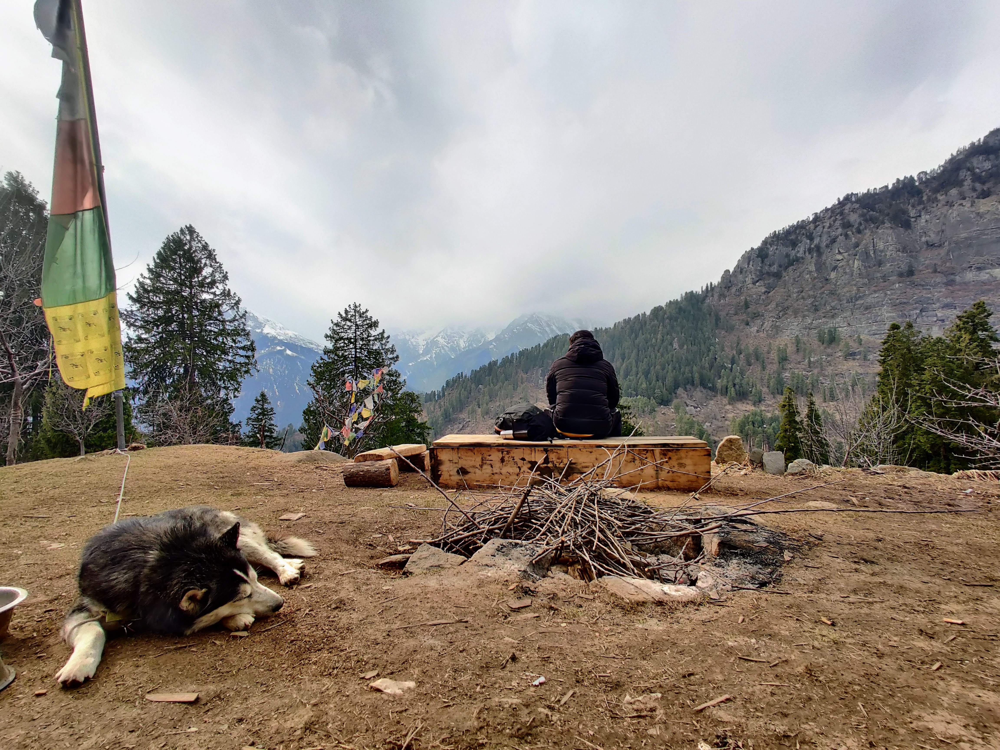

+++
title = "About"
description = "Kanpur-born, Bengaluru-based. Mountains, physics rabbit holes, cooking, and very particular opinions about coffee."
menu = "main"
pageClass = "about"
+++

*Outside The Wilderness Lodge, Sethan, Himachal Pradesh.*

I grew up in Kanpur, in a pretty ordinary middle-class home. I was a late bloomer at most things. I didn't write a single line of code until engineering college, and I've been making up for lost time ever since. These days I live in Bengaluru and work as a data engineer, which is about all I'll say about work on this page.

The mountains are my happy place. I've wandered through Bir, Manali, Kasol, Jibhi, Shoja, Kalpa, Sangla, Rakcham and Chitkul, and this June I trekked to Yulla Kanda. This year I also tried working vacations: a stretch in Mulki to surf, and a whole month in southern Kerala. I loved every bit of it, but for the record, mountains > beaches, and that's not up for debate.

I've always been curious about how the universe works. I can lose an entire evening to the double-slit experiment or the Einstein–Bohr debates, and come out understanding roughly as much as when I started. I also have a theory, entirely unproven, that aliens from another planet had a hand in us being here. Please don't ask for evidence.

Closer to home, I cook, lift at the gym, run, and play table tennis. There's almost always music on. And coffee does not mean instant. It means dark roast I've ground myself, made as a slow pour-over.

I'm open-minded, down to earth, and pretty comfortable in my own company. Still, if I've made someone's day a little easier, that's a good day.



If you're planning a trip to the hills, want to argue about quantum mechanics, or have a coffee recommendation, say hello on [GitHub](https://github.com/amarlearning) or [LinkedIn](https://in.linkedin.com/in/amarlearning).
